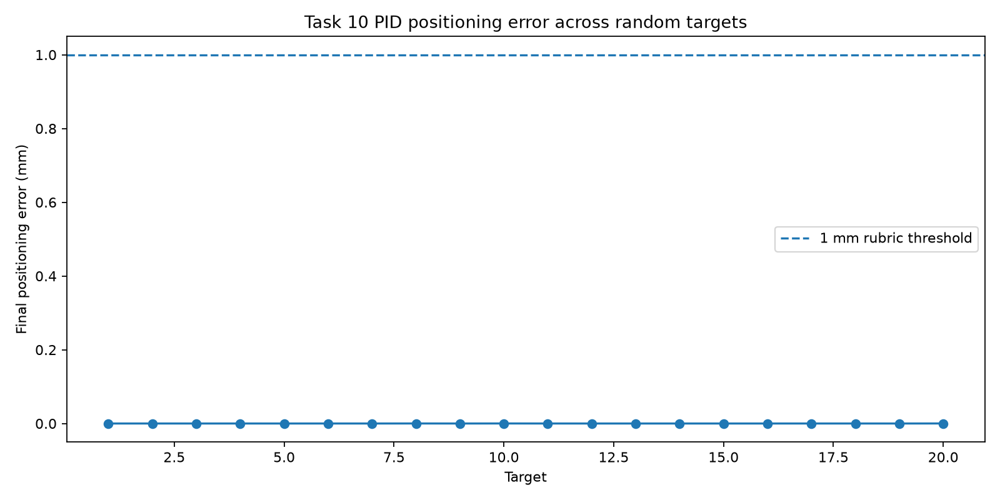
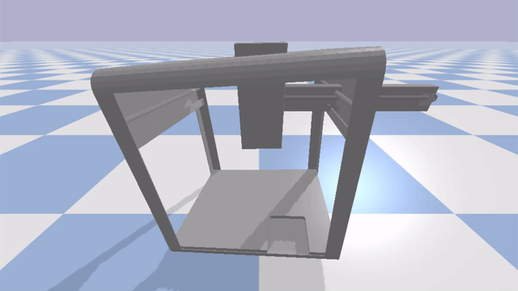

# Task 10 — PID Controller

## Goal

For this task, I developed a PID-based controller for the OT-2 pipette tip. The goal was to move the pipette accurately to arbitrary 3-D coordinates inside the practical work envelope that I determined in Task 9.

I used three independent controllers, one for each axis: X, Y and Z. This allowed each axis to respond to its own positioning error instead of assuming that the robot behaves identically in every direction.

The PID implementation is based on the shared robotics scaffold in `src/ot2/control/pid.py`. I used this implementation as my starting point and performed my own tuning, testing and validation on the local OT-2 PyBullet simulation.

---

## Controller Design

Each controller receives a target coordinate and the current pipette position. The difference between these values is the positioning error.

The PID controller then calculates an action using proportional, integral and derivative terms. In practice, the final tuned controller ended up using only the proportional and integral terms because the best-performing configurations had `Kd = 0`.

This means that although the implementation supports a full PID controller, my final tuned controller behaves as a PI controller.

The proportional term reacts directly to the current positioning error, while the integral term helps remove very small remaining steady-state errors.

The implementation also includes output saturation and anti-windup behaviour so that the integral term does not continue increasing while the controller output is already limited.

For the final high-precision tests, I used:

```text
settle_threshold = 0
min_output = 0
```

This allowed the controller to continue correcting very small errors instead of stopping inside a larger dead band.

---

## Environment

I used the same OT-2 PyBullet simulation environment as in Task 9.

On my local Windows machine, I provided the simulator path using:

```powershell
$env:OT2_SIM_DIR="C:\Users\ASUS\Y2B-2023-OT2_Twin"
```

The main libraries used for this task were:

- Python
- NumPy
- PyBullet
- Matplotlib

The practical work envelope used for testing was:

```text
X: -0.1870 m to 0.2530 m
Y: -0.1705 m to 0.2195 m
Z:  0.1700 m to 0.2895 m
```

These limits were determined during Task 9 and were used to ensure that all PID target coordinates remained inside the reachable workspace.

---

## PID Tuning

The tuning script is:

```text
task10_pid_controller/tune_pid.py
```

I tuned the three axes separately because the simulated robot did not respond exactly the same way along X, Y and Z.

For every axis, I tested nine gain combinations around an initial PI configuration. Each candidate was evaluated on four target positions distributed across the usable range of that axis.

I compared the candidates using both positioning accuracy and settling behaviour. A controller was only considered successful when it settled within the required 1 mm positioning threshold.

The tuning process showed that different gains worked best for each axis. The Z axis especially required stronger proportional control than X and Y.

The selected gains were:

| Axis | Kp | Ki | Kd |
|---|---:|---:|---:|
| X | 58.1873 | 1323.1537 | 0.0000 |
| Y | 77.0519 | 1782.3085 | 0.0000 |
| Z | 103.5513 | 1860.0442 | 0.0000 |

The fact that `Kd = 0` for all three axes was a result of the tuning process rather than a design assumption. The derivative term was supported by the controller, but the best-performing configurations did not require it.

The tuning results are stored in:

```text
results/tuning_results.csv
results/gains_final.json
```

---

## Final Controller Evaluation

After selecting the final gains, I evaluated the controller on random 3-D target positions inside the practical work envelope using:

```powershell
python task10_pid_controller\test_pid.py
```

The initial evaluation used 20 reproducible random targets.

The controller successfully reached all 20 targets with a final positioning error below 1 mm.

The results were:

| Metric | Result |
|---|---:|
| Number of targets | 20 |
| Mean final error | 0.000036 mm |
| Median final error | 0.000008 mm |
| Maximum final error | 0.000190 mm |
| Success rate below 1 mm | 100% |
| Mean settling time | 0.240 s |
| Maximum settling time | 0.333 s |

The final positioning error was calculated as the Euclidean distance between the requested 3-D target coordinate and the final measured pipette position.

---

## Additional Validation

Because the measured simulation errors were extremely small, I did not want to rely on only one fixed random test set.

I therefore repeated the evaluation using three additional random seeds, giving another 60 random target positions in total.

All 60 targets again reached the required accuracy threshold.

Across these three additional validation runs, the largest final positioning error was:

```text
0.000288 mm
```

The approximate mean settling time across the three runs was:

```text
0.243 s
```

The success rate remained:

```text
100% below 1 mm
```

The three validation runs produced maximum errors of approximately:

```text
Seed 101: 0.000288 mm
Seed 202: 0.000252 mm
Seed 303: 0.000128 mm
```

This additional testing gave me more confidence that the result was not caused by one favourable set of target coordinates.

---

## Client Accuracy Requirement

The highest Task 10 accuracy score requires:

```text
Positioning error < 0.001 m
```

This is equivalent to:

```text
Positioning error < 1 mm
```

My worst measured positioning error during the additional validation was approximately:

```text
0.000288 mm
```

This remained far below the required 1 mm threshold.

The controller therefore met the highest accuracy category during my simulation testing.

However, these values should be interpreted as simulation-level numerical accuracy. The PyBullet environment is deterministic and does not include all of the mechanical tolerances, calibration errors, backlash, sensor noise and disturbances that would exist on a physical OT-2 robot.

For that reason, I do not assume that the same microscopic positioning errors would be achievable on real hardware.

---

## Error and Behaviour Analysis

One of the main things I noticed during tuning was that final accuracy alone was not enough to evaluate the controller.

Very aggressive gains can reduce positioning error quickly, but they can also increase overshoot, oscillation or settling time. Because of this, I considered both final error and settling behaviour when selecting the gains.

The three axes also behaved differently. This supported my decision to tune X, Y and Z separately rather than use one shared set of gains.

The final controller showed no failures during the random-target evaluations and typically settled in around a quarter of a second.

The remaining errors were extremely small and close to the numerical precision of the simulation. Increasing the gains further would therefore not provide a meaningful practical improvement and could instead reduce stability.

Another limitation is that all testing was performed in simulation. The controller performance still needs to be interpreted with this limitation in mind when comparing it with a physical robotic system.

---

## Results

The generated evaluation results are stored in:

```text
results/pid_test_results.csv
results/pid_summary.json
results/pid_error_plot.png
```

The positioning-error plot provides a visual overview of the final error for the tested target coordinates.



---

## PID Demonstration

I also ran the final controller with the PyBullet GUI enabled so that I could visually confirm that the pipette moved between target coordinates using the tuned controller.

The final demonstration is shown below:



The GIF is cropped to show only the simulation environment so that the pipette movement is clearly visible.

---

## Project Files

The main files used in this task are:

```text
src/ot2/control/pid.py
    Reusable PID implementation used by the controller.

task10_pid_controller/controller.py
    Loads the tuned gains and creates the three-axis controller.

task10_pid_controller/tune_pid.py
    Tests multiple gain combinations separately for X, Y and Z.

task10_pid_controller/test_pid.py
    Evaluates the final controller on random 3-D target coordinates.

task10_pid_controller/pid_demo_gui.py
    Runs the final PID controller in the PyBullet GUI.

task10_pid_controller/results/
    Contains the tuning results, final gains, evaluation metrics,
    visualizations and demonstration GIF.
```

---

## Conclusion

In this task, I developed and tuned a three-axis controller for the simulated OT-2 pipette.

The final controller achieved a 100% success rate below the client's 1 mm positioning-error threshold on the initial 20-target test and on an additional 60 random validation targets.

The worst positioning error observed during the additional validation was approximately `0.000288 mm`, while the controller typically settled in approximately `0.24 seconds`.

The final gains were different for each axis, confirming that separate tuning of X, Y and Z was useful.

Although the controller supports a full PID formulation, the final tuned configuration used `Kd = 0` for all three axes and therefore behaved as a PI controller.

Based on these results, I will use this PID controller as one of the control methods in the later system integration and benchmarking tasks.
