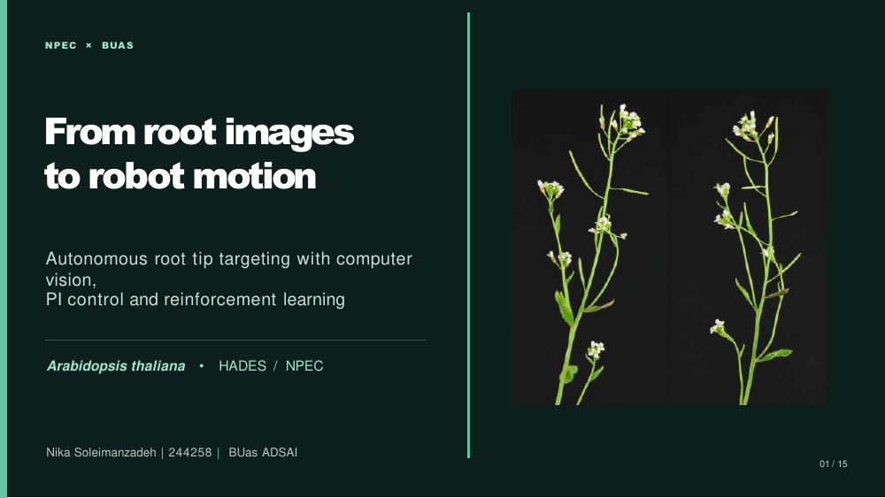

# Task 15 — Final Presentation

## My final solution

I presented my complete root-analysis and simulated robot-control workflow, from Petri dish cropping and U-Net root segmentation through my V5.1 root-start refinement, primary-root measurements, robot coordinates, and the PI-versus-SAC benchmarking results.

I included the important iterations, what worked, what still needs improvement, and how the pipeline could help plant scientists automate repetitive root measurements and target positioning.

## Presentation

**[Open my presentation PDF](../deliverables/task15_presentation/task_15_slides.pdf)**

[Editable PowerPoint](../deliverables/task15_presentation/task_15_slides.pptx)

The submission files are stored in [`deliverables/task15_presentation/`](../deliverables/task15_presentation/), which uses the required Task 15 folder and filename.
