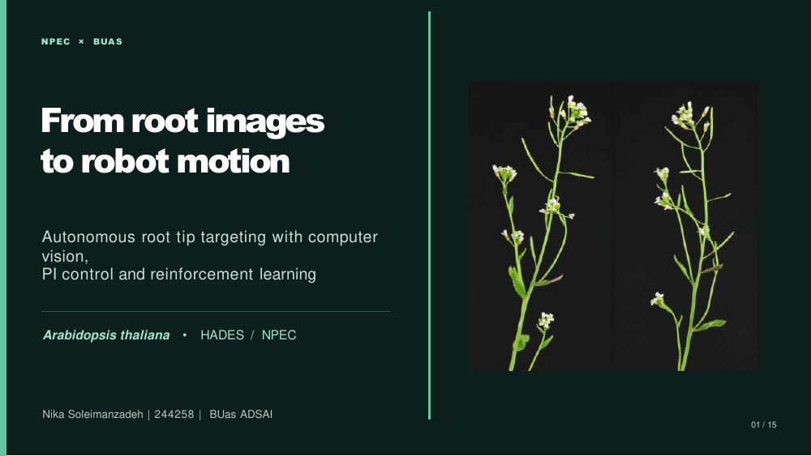

# Project presentation — Final Presentation

## From root images to robot motion

For my final presentation, I brought together my computer vision pipeline and the OT-2 robot control work to demonstrate how an image of plant roots can be turned into simulated robot targets.

I started with Petri dish extraction and root segmentation using a residual U-Net. My V5.1 post-processing pipeline then identified root starting points, assigned roots to plants, and estimated primary root lengths and tip locations. I also explained the improvements I made during development and the final Kaggle performance.

For robotics, I compared a tuned PI controller with a Soft Actor-Critic (SAC) agent. Both were evaluated on the same simulated targets. The PI controller settled at all 13 targets in the final matched benchmark, with a mean final positioning error of 0.179 mm. SAC settled at 12 of 13, with a mean final error of 0.561 mm.

The presentation also covers the limitations. The integrated targets use a simulated coordinate mapping, and the route demonstrations do not establish successful real-world liquid deposition or biological inoculation.

## Presentation files

| File | Purpose |
| --- | --- |
| [`project_presentation.pdf`](project_presentation.pdf) | Final slides for submission |
| [`project_presentation.pptx`](project_presentation.pptx) | Editable presentation |

## Main topics

1. NPEC and the plant-science problem
2. Computer vision and V5.1 root measurement pipeline
3. OT-2 workspace and pixel-to-robot coordinate mapping
4. PI and SAC controller development
5. Integration demonstrations and performance benchmarking
6. Limitations, conclusions and next steps

The detailed implementation, training, and benchmark evidence are documented in the corresponding U-Net root segmentation, Root-length prediction, and Tasks 9–13 folders. This folder contains the presentation deliverable itself.
