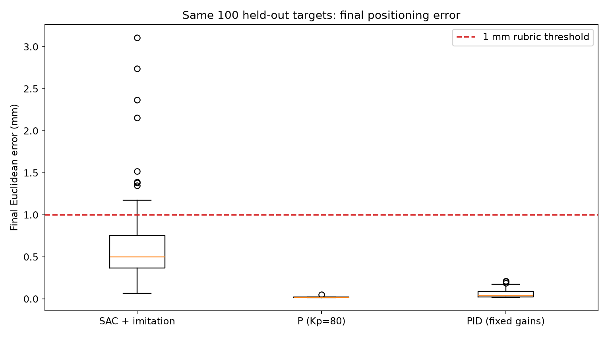
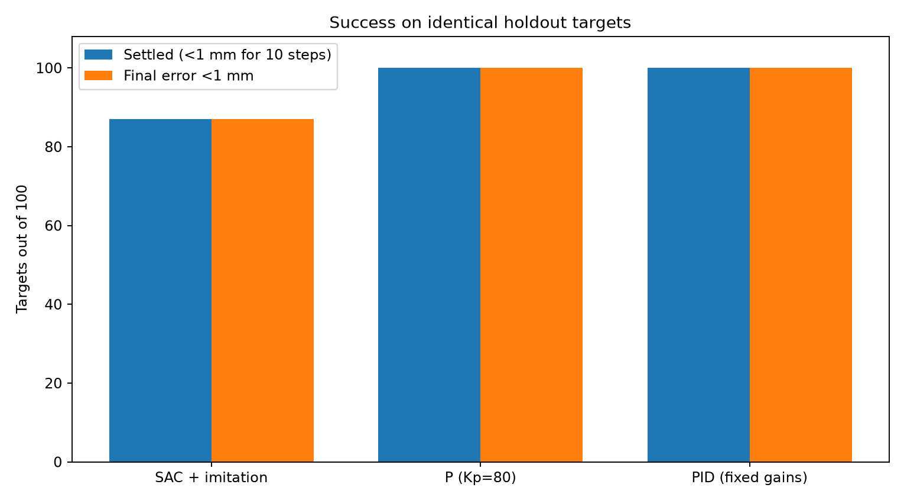
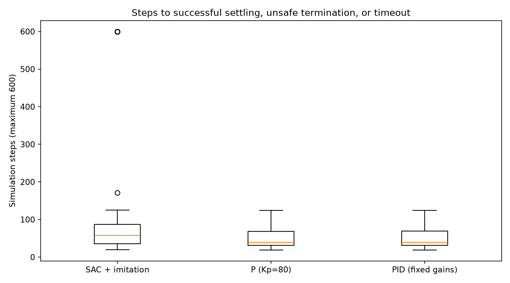
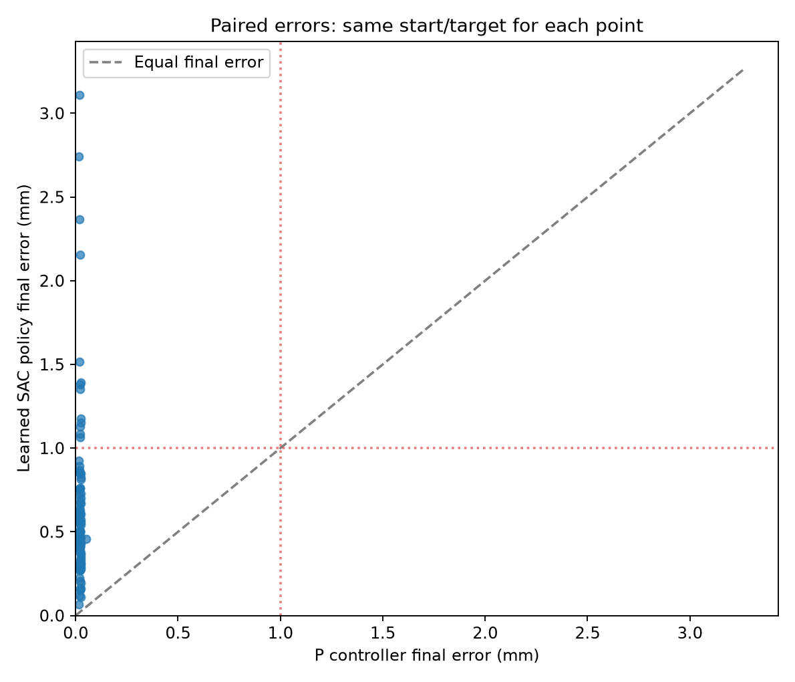
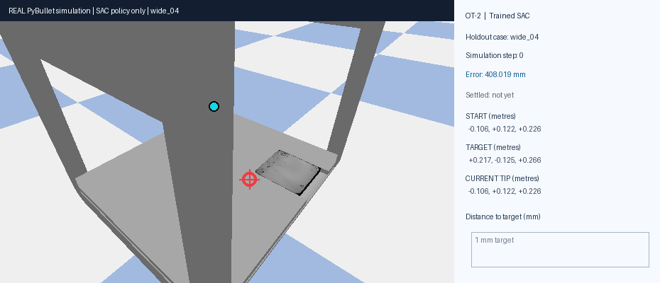
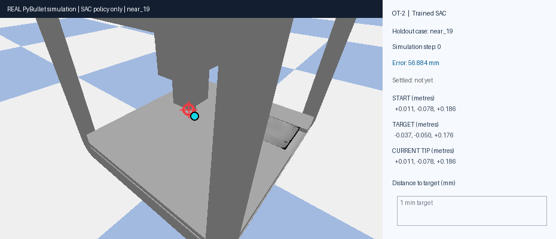

# Task 11 — Reinforcement Learning Controller

## Goal

For this task, I developed a reinforcement learning controller for the simulated Opentrons OT-2 robot. My goal was to make the pipette move to different 3-D target coordinates inside the practical work envelope and reach them with a positioning error below 1 mm.

I used Stable Baselines 3 and Gymnasium to train and evaluate the controller in the PyBullet simulation. I also compared the final learned controller with traditional P and PID control, using the same target coordinates for all three methods.

My final individual model is based on **Soft Actor-Critic (SAC)**. I first trained it with reinforcement learning and then improved its precision using behavior cloning from a proportional controller. The saved model is still a neural-network policy: during testing it predicts its own actions, without calling the proportional controller.

---

## Environment and Controller Design

I used the existing OT-2 PyBullet simulation and the practical work envelope established in the earlier robotics tasks. I built the final Gymnasium environment in [`Path_Y/path_y_env.py`](Path_Y/path_y_env.py) and exposed it through the required [`ot2_gym_wrapper.py`](ot2_gym_wrapper.py).

The environment follows the standard Gymnasium interface, including `reset()`, `step()`, `render()` and `close()`. Each episode starts with a pipette position and a target position. The controller receives information about the robot and decides how to move along X, Y and Z.

I used a **continuous action space with three values**, each between `-1` and `1`. These correspond to movement commands along the three axes. The simulator's separate drop command is kept at zero for this positioning task.

The final observation contains **12 values**: the current position (3), the target displacement at a larger scale (3), the target displacement at a finer scale (3), and the pipette velocity (3). I included the finer error information because accurate control close to a target was one of the main difficulties during training.

I used the collision-free *practical* work envelope rather than assuming that every position within the robot's raw joint limits was safe.

### Reward and termination

I designed the reward to encourage the agent to approach the target while still caring about small positioning errors. The dense part of the final reward uses the Euclidean distance `d` in metres:

```text
reward = -(0.75*d/(d+0.05) + 0.25*d/(d+0.002) + 0.005)
```

I added a **+5 reward for successful settling** and a **-120 penalty for unsafe termination**. An episode counts as successful only when the pipette stays within **1 mm of the target for 10 consecutive simulation steps**. Otherwise, the episode ends if the position becomes unsafe or reaches the limit of **600 steps**.

I used the 10-step condition because I did not want the model to count as successful just because it briefly passed through the target region while still moving.

I also tested the wrapper independently with [`test_wrapper.py`](test_wrapper.py). The final wrapper completed **1,000 random-action steps**, confirming that the interface and simulation could run correctly. This test checks the environment, not the quality of the trained controller.

---

## Training and Experimentation

My main training implementation is [`Path_Y/train_path_y_final_push.py`](Path_Y/train_path_y_final_push.py), with evaluation functions in [`Path_Y/evaluate_sac.py`](Path_Y/evaluate_sac.py).

I used Python, NumPy, Gymnasium, PyBullet, Stable Baselines 3 and PyTorch. I used Matplotlib for the comparison plots and Pillow for the GIF evidence.

### SAC configuration

| Hyperparameter | Value |
|---|---:|
| Algorithm | SAC (`MlpPolicy`) |
| Actor and critic hidden layers | 128, 128 |
| Learning rate | 0.0003 |
| Discount factor (`gamma`) | 0.99 |
| Batch size | 128 |
| Replay buffer size | 100,000 |
| Initial exploration steps | 500 |
| Target smoothing (`tau`) | 0.005 |
| Training frequency | 1 |
| Gradient steps | 1 |
| Entropy coefficient | Automatic |

I trained SAC using different start and target positions inside the practical work envelope. I saved checkpoints and compared their performance on fixed cases instead of relying only on training reward.

### What I changed during training

The initial SAC model learned to move towards targets, but I noticed that it struggled with the last few millimetres. Close to the target, it often oscillated or made large corrections instead of settling consistently. More SAC training did not reliably solve this problem.

I kept the **53,000-step SAC checkpoint** as the base model. On the 40-case model-selection set, that original checkpoint settled **11/40 targets**, with a mean final error of approximately **1.938 mm**.

To improve its precision, I then collected **250 successful expert trajectories** from a proportional controller with `Kp = 80`. I also used states from the existing SAC replay data to create additional supervised training examples. I fine-tuned a copy of the SAC actor using behavior cloning, rather than replacing the controller with a hard-coded P-controller.

I tested the actor after different numbers of behavior-cloning updates. The best result came after **3,500 updates**, using a behavior-cloning learning rate of **0.0001**. On the same 40 selection cases, it settled **33/40 targets** with a mean final error of approximately **0.717 mm**.

I also tested additional SAC training after the behavior-cloning stage, but it made the results worse. For that reason, I selected the **3,500-update behavior-cloning checkpoint** instead of the later SAC checkpoints.

This is an important distinction in my results: **the final model was initialized through reinforcement learning and then improved through supervised imitation learning**. I am not claiming that SAC alone achieved the final precision.

---

## Final Model and Evaluation

After selecting the best checkpoint, I evaluated it on a **separate set of 100 start/target cases** that I had not used for model selection. The set contained near-target and larger-distance movements across the practical work envelope.

I calculated positioning error as the Euclidean distance between the final measured pipette position and the requested target, reported in millimetres.

| Metric | Final result |
|---|---:|
| Test cases | 100 |
| Mean final positioning error | **0.6411 mm** |
| Successfully settled within 1 mm | **87/100** |
| Final errors below 1 mm | **87/100** |
| Maximum final error | **3.1110 mm** |
| Mean simulation steps | **127.2** |
| Unsafe episodes | **0** |

I loaded the saved model again after cleaning the project folder and repeated the evaluation on the **same 100 holdout cases**. It reproduced the original result exactly: **0.64112572 mm mean error, 87 settled targets and zero unsafe episodes**.

The client requires positioning error below `0.001 m`, or **1 mm**, for the highest accuracy category. My model achieved a mean error below that threshold, but **13 of the 100 cases did not settle within 1 mm**. I therefore cannot claim that every target meets the highest accuracy category. The rubric does not state how errors from multiple targets are aggregated.

### Saved model weights

My selected individual model is saved here:

[`Path_Y/runs/final_push_20261012_155636_757034/best_learned_sac_model.zip`](Path_Y/runs/final_push_20261012_155636_757034/best_learned_sac_model.zip)

I also preserved the original 53k-step SAC checkpoint and replay buffer for training provenance:

`Path_Y/runs/sac_continue43k_20261011_201840_630818/checkpoints/`

The final model's verified SHA-256 fingerprint is:

```text
1ea690ff84ecbc3965cd36cee90fa406ed11db5bd784d1ac8a3cf211ed80b4e5
```

The holdout cases, evaluation CSV and training summaries are stored under `Path_Y/runs/final_push_20261012_155636_757034/`.

---

## Comparison with Traditional Controllers

I compared the final learned model with a **P-controller (`Kp = 80`)** and a **fixed-gain PID-controller** on the exact same 100 held-out targets.

For this comparison, I used the same simulator, workspace, target positions and success conditions. The PID configuration in this comparison was a fixed reference (`Kp = 80`, `Ki = 0.25`, `Kd = 0.01`), **not the separately tuned PI controller from Task 10**.

| Controller | Mean final error | Settled targets | Mean steps |
|---|---:|---:|---:|
| SAC + behavior cloning | **0.6411 mm** | **87/100** | **127.2** |
| P-controller | 0.0219 mm | 100/100 | 50.9 |
| Fixed-gain PID | 0.0627 mm | 100/100 | 51.0 |

The traditional controllers performed better in this benchmark. Both reached every target more accurately and in fewer steps than the learned controller. The RL model did learn independent control and reached sub-millimetre **mean** error, but it was not as consistent as the P/PID baselines.

This comparison also influenced my choice for Task 12. Since the integration task allows either PID or RL, I would prefer the better-performing traditional controller for precise inoculation rather than assume that the RL model is the best option simply because it is learned.

I generated the results using [`compare_final_controllers.py`](compare_final_controllers.py). The plots and raw data are saved in `evidence/comparison_20261012_165748_745665/`.









---

## RL Demonstrations

I also recorded two successful movements using the **saved neural model** in the PyBullet simulation. I generated the GIFs directly from simulator frames with [`create_rl_movement_gifs.py`](create_rl_movement_gifs.py), rather than manually recording the screen.

For the longer movement, the pipette started **408.02 mm** away from its target and finished with **0.2065 mm** error after **105 steps**.



For the shorter movement, the initial distance was **56.88 mm** and the final error was **0.2759 mm** after **40 steps**.



Both demonstrations use the trained neural policy to choose the actions. They are examples of successful movement, not a replacement for the full 100-case evaluation.

---

## Project Files and Reproduction

The main files for my final implementation are:

```text
task11_rl_controller/
    README.md                      Documentation and final results
    ot2_gym_wrapper.py             Required Gymnasium wrapper entry point
    test_wrapper.py                1,000-step random-action environment test
    compare_final_controllers.py   RL, P and PID evaluation and plots
    create_rl_movement_gifs.py     Automatic PyBullet GIF generation
    Path_Y/
        path_y_env.py             Final 12-observation environment
        train_path_y_final_push.py Individual model training and fine-tuning
        evaluate_sac.py           Learned-controller evaluation functions
        runs/                     Selected weights and training evidence
    evidence/                      Comparison figures, CSVs and GIFs
```

From the repository root, with the project dependencies installed and the OT-2 simulator available, I used:

```powershell
python -B .\task11_rl_controller\test_wrapper.py
python -B .\task11_rl_controller\compare_final_controllers.py
python -B .\task11_rl_controller\create_rl_movement_gifs.py
```

The comparison and GIF scripts **load the already trained model** and save new evidence. They do not retrain or replace its weights. The training script is included to document how I created the model; rerunning it starts a new training experiment and is not needed to reproduce the evaluation scores.

I completed the controller development, experimentation, hyperparameter adjustments and evaluation individually as part of my retake. The assignment describes a group hyperparameter search, but my reported results are from my individual experiments. I have therefore not included group model weights or results that were not produced.

---

## Conclusion

In this task, I developed a Gymnasium environment and a learned controller for OT-2 pipette positioning. I started with SAC, tested its performance, and found that its main weakness was accurate settling close to the target. I improved the saved policy by fine-tuning the SAC actor using expert behavior-cloning data.

The final model achieved **0.6411 mm mean positioning error** on 100 unseen test cases, with **87/100 successful settled movements and no unsafe episodes**. I independently reran the stored model and reproduced the result exactly.

My comparison showed that traditional P and PID control still gave better accuracy and faster settling in this simulation. The main outcome of this task was therefore not that RL replaced classical control, but that I built and evaluated a working learned controller and could compare its strengths and limitations using the same experimental conditions.

All results are simulation results. They do not account for real-world calibration errors, mechanical tolerances and disturbances on a physical OT-2 robot.
