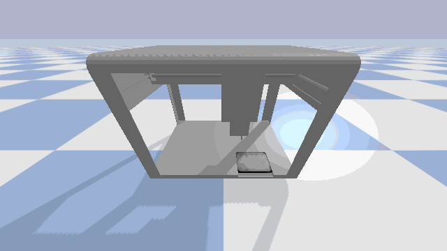

# Task 9 — Robotics Environment Interaction

## Goal

For this task, I worked with the Opentrons OT-2 PyBullet simulation to understand how the robot can be controlled and what information can be retrieved from the environment.

Before building a PID or reinforcement learning controller, I wanted to understand the basic behaviour of the simulated robot first. I therefore tested movement along the X, Y and Z axes, inspected the observations returned by the simulator, and determined the practical work envelope of the pipette tip.

The most important result from this task was establishing the coordinate limits that I could safely use in the later controller tasks.

---

## Environment Setup

I ran the OT-2 simulation locally on Windows using Python and PyBullet.

The BUas simulator itself is stored separately from my repository, so I used the `OT2_SIM_DIR` environment variable to tell my code where the simulator files are located.

On my machine I used:

```powershell
$env:OT2_SIM_DIR="C:\Users\ASUS\Y2B-2023-OT2_Twin"
```

Before running the experiments, I used:

```powershell
python task09_robotics_environment\check_setup.py
```

This checks whether the simulator directory and `sim_class.py` can be found correctly.

The main dependencies I used in this task were:

```text
Python
NumPy
PyBullet
imageio
```

---

## Exploring the Robot

I first wanted to see how the simulator reacts to simple commands before trying to control the robot automatically.

For this I created:

```text
task09_robotics_environment/task09_interaction.py
```

The script sends positive and negative commands along X, Y and Z and reads the resulting simulator observations.

For every movement I looked at:

- pipette position;
- pipette velocity;
- distance between the pipette and a reference target;
- lower-level joint information returned by the simulator.

For example, the simulator exposes information such as joint positions, joint velocities, motor torque and reaction forces in addition to the Cartesian pipette position.

I found the Cartesian pipette coordinates much more useful for the later controller tasks because these directly represent where the pipette tip is located in the workspace.

The observations from this experiment are stored in:

```text
results/interaction_observations.json
```

---

## Understanding the Coordinate System

One thing I noticed while inspecting the simulator state was that the individual joint values should not be interpreted as if they directly represent Cartesian movement.

For example, the sign of a joint velocity does not necessarily correspond directly to the visible direction of the pipette along X, Y or Z.

Because the later tasks require the pipette to reach actual physical positions, I therefore based my controller calculations on the Cartesian pipette coordinates rather than directly using joint coordinates.

This also makes it easier to calculate the distance between the current pipette location and a target position.

---

## Determining the Work Envelope

The next step was finding the practical movement boundaries of the pipette.

I tested all eight combinations of the minimum and maximum X, Y and Z coordinates. This represents the eight corners of the 3-D workspace.

The work envelope I determined was:

```text
X: -0.1870 m to  0.2530 m
Y: -0.1705 m to  0.2195 m
Z:  0.1700 m to  0.2895 m
```

These coordinates became the workspace limits used later when generating target positions for the PID and reinforcement learning controllers.

---

## Eight-Corner Test

I tested each corner individually and compared the requested target coordinate with the position actually reached by the pipette.

The results were:

| Corner | Target X (m) | Target Y (m) | Target Z (m) | Final error (mm) | Steps |
|---:|---:|---:|---:|---:|---:|
| 1 | -0.1870 | -0.1705 | 0.1700 | 0.630 | 122 |
| 2 | -0.1870 | -0.1705 | 0.2895 | 0.605 | 77 |
| 3 | -0.1870 | 0.2195 | 0.1700 | 0.591 | 196 |
| 4 | -0.1870 | 0.2195 | 0.2895 | 0.606 | 77 |
| 5 | 0.2530 | -0.1705 | 0.1700 | 0.608 | 218 |
| 6 | 0.2530 | -0.1705 | 0.2895 | 0.604 | 77 |
| 7 | 0.2530 | 0.2195 | 0.1700 | 0.590 | 196 |
| 8 | 0.2530 | 0.2195 | 0.2895 | 0.604 | 77 |

The mean final error across the eight corners was approximately:

```text
0.605 mm
```

The largest error was:

```text
0.630 mm
```

All eight corners were therefore reached with less than 1 mm of final positioning error.

The complete results are stored in:

```text
results/eight_corners.csv
```

---

## Robot Behaviour

The robot behaved consistently throughout the work-envelope experiment.

One noticeable difference was the number of simulation steps required to reach different targets. Some large horizontal movements required more than 190 simulation steps, while several Z movements required only around 77 steps.

For example, moving to corner 5 required 218 steps, while moving between some upper and lower Z positions required only 77 steps.

This showed me that movement time depends on both the distance to the target and the axis being moved.

This becomes important in the next tasks because controller quality should not only be judged by final accuracy. Settling time and movement behaviour are also useful when comparing different controllers.

---

## Eight-Corner Demonstration

I also ran the eight-corner experiment with the PyBullet graphical interface enabled.

The GIF below shows the pipette moving through the different boundaries of the workspace:



This gave me a visual check that the coordinates recorded by the script corresponded to actual movement of the simulated robot.

---

## Project Structure

The files I used for this task are organised as follows:

```text
task09_robotics_environment/
├── README.md
├── check_setup.py
├── task09_interaction.py
├── eight_corners.py
├── eight_corners_gui.py
└── results/
    ├── interaction_observations.json
    ├── eight_corners.csv
    └── corners.gif
```

`check_setup.py` checks that the simulator is available.

`task09_interaction.py` is used to experiment with movement commands and inspect simulator observations.

`eight_corners.py` measures the operational workspace and records the reached positions.

`eight_corners_gui.py` runs the same work-envelope experiment with the PyBullet graphical interface enabled.

---

## Conclusion

This task gave me a working understanding of how to interact with the simulated OT-2 before developing automatic controllers.

I was able to send commands along all three Cartesian axes, retrieve and process simulator observations, calculate distances to targets, and inspect the lower-level robot state.

I also determined the practical pipette work envelope:

```text
X: -0.1870 m to  0.2530 m
Y: -0.1705 m to  0.2195 m
Z:  0.1700 m to  0.2895 m
```

All eight corners of this workspace were successfully reached with sub-millimetre final error.

The work envelope and simulator behaviour established in this task provide the coordinate limits and basic robot understanding that I use in Task 10 for PID control and later in the reinforcement learning and system-integration tasks.