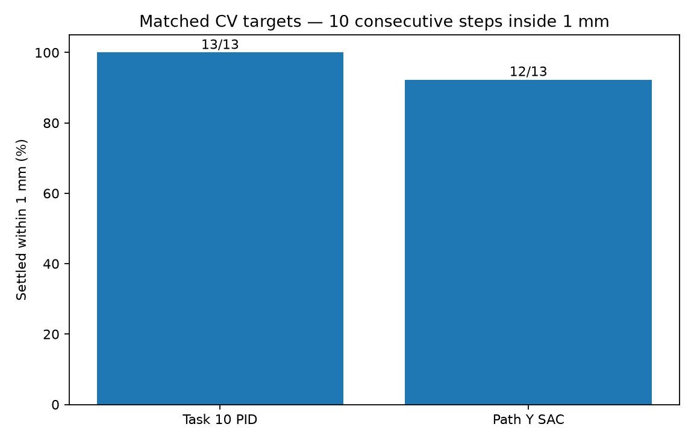
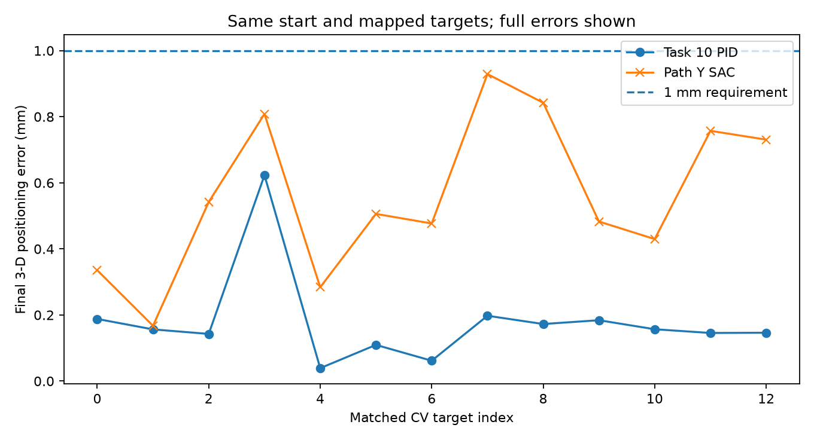
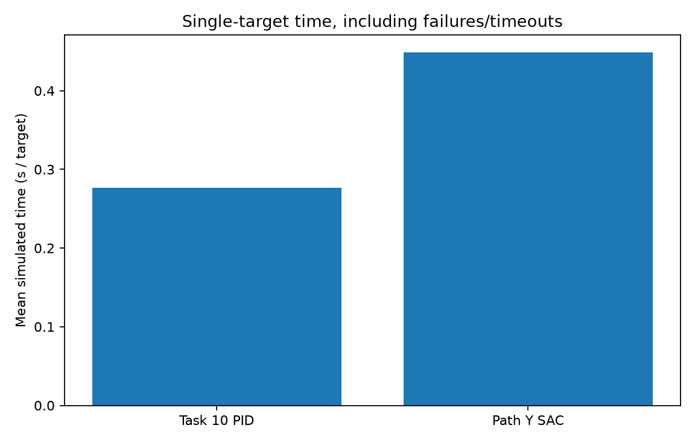

# Tasks 12–13 — CV-to-Robot Integration and Performance Benchmarking

## Task 12 — System Integration

For this task, I connect the root-tip coordinates from my existing CV pipeline to the OT-2 controller that I developed and tuned in Task 10. I chose the PID/PI controller for integration because my previous simulator tests showed reliable sub-millimetre **positioning** accuracy. I did not retrain a model or change my PID gains for this task.

My original Task 5–7 notebook is the source of the detections, rather than a separate root detector. It produces `task7_primary_root_lengths.csv`, which includes `image`, `plant`, `tip_x`, `tip_y`, and `status`. The tip coordinates are relative to each **cropped Petri image**, and `petri_crop_metadata.csv` stores the crop width and height. I use those dimensions directly; adding the raw-photo bounding-box offsets to the cropped tip positions would be a coordinate-frame error.

### How the stages connect

1. Read the Task 7 root-tip CSV. Initially accept `OK` rows only; exclude `CHECK` and `FAILED` targets until they have been reviewed.
2. Read crop dimensions from the original Task 5 metadata for each image.
3. Convert crop-local tip `(x pixel, y pixel)` into a world-frame OT-2 `(X metres, Y metres)` using the selected plate calibration. Choose a safe, reachable world-frame Z hover height separately.
4. Check that every requested 3-D target is inside the practical work envelope from Task 9.
5. For each image/plate, run the **original Task 10** controller. First approach above the selected tip at safe transit Z, descend to its hover target, require **10 consecutive simulation steps** within **1 mm**, then retreat. The PID is reset per waypoint.
6. Only after successful positioning, mark a **simulated deposit** in the output GIF. This is a visualization of the intended action, not proof of a real liquid drop or biological inoculation.
7. Save the target manifest, per-target execution results, a summary and, when Petri previews are provided, a GIF for each plate.

### Coordinate transformation and calibration limits

The transformation is an affine map, using crop-local pixel positions:

```text
[X_m]   [a  b  tx] [tip_x_px]
[Y_m] = [c  d  ty] [tip_y_px]
                   [   1    ]

Z_m = configured reachable hover height
```

For an independently calibrated system I need measured pixel-to-world landmark pairs with a consistent plate position and known orientation. Fitting an affine to >=3 non-collinear points is straightforward, but an *independent held-out* calibration check is needed to estimate real mapping error. A perfect round trip is not evidence that the camera and robot agree physically. Calibration and CV tip-location errors both contribute to actual inoculation error.

I use an **explicitly unverified image-to-world mapping**, with the same stated simulation axis convention as the reference example. The specimen geometry itself was checked in **my own simulator**: `sim_class.py` defines a placement offset `(0.1827, 0.1370, 0.0570)` metres relative to the base, `custom.urdf` contains a `150 × 150 × 15 mm` box, and PyBullet returned a loaded specimen pose `(0.1827, 0.1370, 0.0870)` metres with yaw `−π/2`. The specimen top is at `Z ≈ 0.0945 m`.

The coordinate convention is image **columns right → world +Y** and **rows down → world −X**. With crop width `W`, height `H`, and the confirmed plate centre, the assumed transform is:

```text
X_world = 0.2577 - 0.150 * tip_y / H
Y_world = 0.0620 + 0.150 * tip_x / W
Z_hover = 0.1750 m
```

The chosen `Z_hover` is about **80.5 mm above** the plate's top face. It demonstrates hovering/targeting, **not actual tip-to-agar contact**. Although the **plate geometry is confirmed**, the mapping of each photographed image to that plate has no independently measured landmarks. It remains an *assumption*, not verified biological root-tip calibration. This is why `calibration_verified` remains `false` and execution requires `--allow-assumed-plate-map`.

The Task 9 practical workspace was X `[-0.1870, 0.2530]` m, Y `[-0.1705, 0.2195]` m, Z `[0.1700, 0.2895]` m. Targets outside it are rejected, not silently clipped. The safe transit height in this implementation is `0.245` m. Movement inside the simulator is driven with action `[ax, ay, az, 0.0]` and `dt=1/240 s`, just as in my Task 10 code.

### Project files

`cv_adapter.py` loads my Task 7 output and crop metadata. `calibration.py` handles either a measured affine or an explicitly assumed simulation mapping. `simulate_pid.py` uses my actual Task 10 PI controller and Task 9 simulator functions. `run_integration.py` brings these parts together. `demo_gifs.py` draws real recorded simulator movement over the original Petri crop and marks successful simulated deposits. `export_cv_handoff.py` packages just the necessary CV outputs from the school server.

### Preparing the CV data from my school server

My Task 8 notebook saves the files at `/home/y2a/task8_clean_pipeline/outputs`. The generated CSVs and crop images were already present on disk; I did **not** restart the kernel or retrain. For another export, I can run:

```bash
python task12_13_integration_benchmarking/export_cv_handoff.py
```

This produces `/home/y2a/task12_cv_handoff.zip`, containing the two CSVs and small display previews of the Petri crops. The previews are resized only for GIF creation; my pixel coordinates and original crop dimensions stay unchanged.

### Run from the robotics repository root (PowerShell)

The command below is **dry-run only**. It checks the root tips, coordinate conversion and workspace limits, and writes the target manifest. It does not control the simulator:

```powershell
python task12_13_integration_benchmarking/run_integration.py `
  --tips-csv task12_cv_handoff/task7_primary_root_lengths.csv `
  --crop-metadata task12_cv_handoff/petri_crop_metadata.csv `
  --calibration task12_13_integration_benchmarking/plate_config.example.json `
  --allow-assumed-plate-map `
  --max-plates 3
```

After checking the manifest and verifying the simulated specimen geometry, run the simulator with the **assumed image convention explicitly allowed** and save the GIFs:

```powershell
python task12_13_integration_benchmarking/run_integration.py `
  --tips-csv task12_cv_handoff/task7_primary_root_lengths.csv `
  --crop-metadata task12_cv_handoff/petri_crop_metadata.csv `
  --calibration task12_13_integration_benchmarking/plate_config.example.json `
  --allow-assumed-plate-map `
  --previews task12_cv_handoff/previews `
  --max-plates 3 `
  --execute `
  --gif-3d
```

The existing environment must have NumPy, PyBullet and Pillow installed, with `OT2_SIM_DIR` pointing to the course simulator folder containing `sim_class.py`. I have not bundled or modified that simulator. To use a measured per-image affine instead, replace the example config with measured values and remove `--allow-assumed-plate-map`.

### Four-point simulation calibration check

`verify_simulation_calibration.py` tests the centre, inverse mapping, four synthetic image quadrant centres, the row/column signs, and the target separation on the original crop dimensions for the selected plates. With `--with-sim` it also loads my own PyBullet specimen to check its XY centre, box dimensions, top-face Z, and −90° rotation. It **does not** verify alignment between a real photograph and the simulator, and cannot be used to claim physical camera calibration.

From the robotics repo root:

```powershell
$env:OT2_SIM_DIR = "C:\Users\ASUS\Y2B-2023-OT2_Twin"
python -m pytest task12_13_integration_benchmarking/tests -q
python task12_13_integration_benchmarking/verify_simulation_calibration.py --with-sim
```

The verification script writes `results/task12_calibration_checks.json`. It does not move the pipette. **Observed check on my Windows simulator (13 October 2026):** all 10 automated tests passed. The four-point geometry tests passed for `test_image_01`, `test_image_02` and `test_image_04`; the maximum pixel round-trip residual printed across these plates was `2.27e-13 px`. Loading the PyBullet specimen confirmed centre `(0.1827, 0.1370, 0.0870)` metres and box size `(0.15, 0.15, 0.015)` metres. Results were written to [`results/task12_calibration_checks.json`](results/task12_calibration_checks.json). These are simulation checks **only**; image registration remains unverified.

### My measured Task 12 simulation results (12 October 2026)

The original Task 7 pipeline reported **87 root records, of which 76 were `OK`**. I selected the first three usable images (13 accepted root-tip coordinates in total) and ran the **original Task 10 PI controller** in the OT-2 PyBullet simulation. For each target it moved to a safe transit Z, approached a hover target, required 10 consecutive steps with 3-D error below 1 mm, marked a simulated deposit, and retreated. These are my own run results, not copied from the reference project.

| Specimen image | Accepted targets positioned / selected |
|---|---:|
| `test_image_01` | 4/4 |
| `test_image_02` | 5/5 |
| `test_image_04` | 4/4 |
| **Total** | **13/13 (100%)** |

| Metric | Observed value |
|---|---:|
| Mean 3-D PID position error relative to mapped target | **0.442769 mm** |
| Maximum 3-D PID position error relative to mapped target | **0.443262 mm** |
| Targets below the 1 mm controller threshold | **13/13** |
| Simulation deposits marked after successful positioning | **13** |
| All photographed plate calibrations independently verified? | **No** |

These values come from the `--execute --gif-3d` run and its saved `results/task12_pid_summary.json` and `results/task12_pid_position_results.csv`. **The errors compare measured pipette positions to the commanded, assumed-mapped coordinates.** They are not independent biological tip localization errors or measured liquid deposition errors. The observed ~0.443 mm error reflects the integration's early stop after 10 consecutive steps inside the 1 mm threshold; it is not the same endpoint criterion as the high-precision Task 10 standalone evaluation.

### GIF evidence (my own PyBullet runs)

The GIFs show the measured pipette trajectory in the simulator alongside the Petri preview, CV root-tip markers, and blue *simulated* deposit markers:

- [Plate 01, four selected roots](gifs/test_image_01_pid.gif)
- [Plate 02, five selected roots](gifs/test_image_02_pid.gif)
- [Plate 04, four selected roots](gifs/test_image_04_pid.gif)

The source data are in `task12_cv_handoff/` and the integration code is `run_integration.py`, `cv_adapter.py`, `calibration.py`, `simulate_pid.py`, and `demo_gifs.py`. The GIFs have been manually inspected. The PyBullet view is a **visual simulation**, not physical dispensing or independently validated plate-photo registration.

### Task 12 deliverables and ILO 8.6D evidence

Link this README, [integration code](run_integration.py), [Task 10 controller](../task10_pid_controller/controller.py), and the three GIFs above under learning-log section C / ILO 8.6D when GitHub repository access is restored. Source files and results are stored in my local `robotics-pipeline` branch. The availability of remote links depends on GitHub write permissions and the final push; I will verify published URLs before adding them to the learning log.

### For independently measured calibration

If I obtain actual measured plate landmarks in **crop-local pixels** and world-frame metres, I can fit an affine per image with `fit_plate_calibration.py`. The landmark CSV columns are `image,split,pixel_x,pixel_y,robot_x_m,robot_y_m,width,height,hover_z_m`, where `split` is `fit` or `holdout`. I need at least three non-collinear fit points and a **separate** held-out point per image. The script reports both fit RMSE and held-out maximum error; the default mapping verification threshold is 0.5 mm, leaving only a limited margin for root detection and motion errors.

```powershell
python task12_13_integration_benchmarking/fit_plate_calibration.py `
  --landmarks task12_plate_landmarks.csv `
  --output task12_13_integration_benchmarking/plate_config.measured.json
```

For a GIF that shows the PyBullet camera beside the crop overlay, include `--gif-3d` with `--execute`. This renders an actual scene view, not a saved video from somebody else's experiment. The blue markers on the Petri image still only mean that a position was reached and *a deposit event was simulated*.

The optional 3-D PyBullet view places small non-physical visual markers over the assumed plate surface after the pipette settles. These markers are not the simulator's dispensing mechanism and should be described as *simulated deposits*, not droplets that were physically dispensed.

## Task 13 — Performance Benchmarking and System Evaluation

### Objective and comparison design

I evaluated the precision, reliability and execution time of my **Task 10 tuned PID/PI controller** and my **Task 11 Path Y Soft Actor-Critic (SAC) controller** on the mapped CV root-tip coordinates produced in Task 12. Both controllers are my own work. I used the final trained SAC checkpoint as-is and did not retrain it for this evaluation; I used the original Task 10 PID gains without retuning them.

The dataset for the comparison consists of **13 accepted (`OK`) root-tip targets from three specimen images** (`test_image_01`, `test_image_02`, `test_image_04`). These are the same requested coordinates in the Task 12 target manifest, not new or manually chosen robot coordinates.

The principal experiment is a **matched, isolated single-target controller comparison**, implemented in [`benchmark_task13.py`](benchmark_task13.py). For every target, both controllers receive:

- the same mapped 3-D target and the same fixed starting pose (the practical work-envelope centre);
- the same `PathYEnv` and underlying OT-2 PyBullet simulation;
- a maximum of **600 simulation steps** at **240 Hz**;
- the same positioning threshold of **less than 1 mm**, with successful *settling* defined as **10 consecutive steps** within that threshold.

The PID uses measured simulator position with the existing Task 10 controller and is reset for each target. SAC uses its original **12-dimensional observation**, deterministic policy inference and **three-dimensional continuous actions**. Both start anew for each trial. Neither controller receives help from the other during evaluation. The SAC model's SHA-256 reported by the benchmark was `1ea690ff84ecbc3965cd36cee90fa406ed11db5bd784d1ac8a3cf211ed80b4e5`.

I record final 3-D positioning error, whether the endpoint was inside 1 mm, whether the settling condition was actually met, simulation steps, simulated elapsed time and any failures. `simulated_time_s = steps / 240`; wall-clock execution time is also logged in the CSV but is hardware-dependent and **not** a measure of physical OT-2 speed. These single-target times must not be confused with Task 12's approach–hover–retreat route times.

### Quantitative results — matched 13-target benchmark (13 October 2026)

| Metric | Tuned PID / PI | Final Path Y SAC |
|---|---:|---:|
| Targets / specimen plates | 13 / 3 | 13 / 3 |
| Settled within 1 mm for 10 consecutive steps | **13/13 (100%)** | 12/13 (92.3%) |
| Final position within 1 mm | 13/13 (100%) | 13/13 (100%) |
| Mean final 3-D error | **0.1787 mm** | 0.5609 mm |
| Maximum final 3-D error | **0.6229 mm** | 0.9291 mm |
| Average simulated time, including failures | **0.277 s** | 0.448 s |
| Average simulated time on SAC's 12 settled targets | — | approximately 0.277 s |

**Result:** On these 13 mapped targets, PID was more precise and settled more reliably. The larger average SAC time is mainly due to **one trial consuming the entire 600-step budget (2.50 simulated seconds)**. Excluding that failure to describe *successful SAC trajectories only* yields approximately 0.277 s per settled target; that conditional average should not replace the all-target comparison above.

The one SAC settling failure was **`test_image_02`, plant 5**. Its final positioning error was **0.8422 mm**, below 1 mm, but it did not stay below the threshold for ten consecutive steps before the 600-step timeout. This distinction matters: **a final point inside tolerance is not necessarily a stable target acquisition**. There were no reported PID settling failures in the matched benchmark.

The raw evaluation results, per-target pairing, full summary and plots are saved in [`results/task13_benchmark_20261013_144535/`](results/task13_benchmark_20261013_144535/). The small two-target smoke test run is not used as the final benchmark result.

### Benchmark visualizations

**Settling success:**



**Positioning error for each matched CV target (dashed line = 1 mm limit):**



**Average simulated execution time (all cases, including timeout):**



The underlying [`task13_pid_cases.csv`](results/task13_benchmark_20261013_144535/task13_pid_cases.csv), [`task13_sac_cases.csv`](results/task13_benchmark_20261013_144535/task13_sac_cases.csv), [`task13_matched_targets.csv`](results/task13_benchmark_20261013_144535/task13_matched_targets.csv) and [`task13_summary.json`](results/task13_benchmark_20261013_144535/task13_summary.json) allow the charts and aggregates to be checked without relying on screenshots. An automatically generated supporting report is available at [`task13_results.md`](results/task13_benchmark_20261013_144535/task13_results.md).

### Sequential autonomous route demonstration

I also tested the trained SAC policy in a **sequential multi-waypoint approach → hover → retreat route**, using [`demo_task13_sac.py`](demo_task13_sac.py). This experiment retains the robot's state between successive waypoints on each plate and uses no PID assistance or teleportation between them. A simulated deposit marker is added **only when both approach and hover have settled**; failed targets are not marked as successful.

| Plate | SAC simulated deposits / selected targets |
|---|---:|
| `test_image_01` | 3/4 |
| `test_image_02` | 3/5 |
| `test_image_04` | 3/4 |
| **Total** | **9/13 (69.2%)** |

This separate route test recorded **three hover timeouts** (`test_image_01` plant 4, `test_image_02` plant 5, `test_image_04` plant 5) and **one approach failure** (`test_image_02` plant 4). The detailed results are saved in [`results/task13_sac_route_results.csv`](results/task13_sac_route_results.csv).

For reference, my **Task 12 PID route** marked 13/13 simulated deposits on the same selected plates. However, the original Task 12 PID route and this SAC route are separate implementations, not the matched single-target protocol; I present their route outcomes as **qualitative system evidence**, not a controlled head-to-head speed or accuracy estimate.

The animated demonstrations use the actual simulator trajectories and cropped Petri previews, with simulated deposit markers:

| Specimen image | PID animation | SAC animation |
|---|---|---|
| `test_image_01` | [PID GIF](gifs/test_image_01_pid.gif) | [SAC GIF](gifs/test_image_01_sac.gif) |
| `test_image_02` | [PID GIF](gifs/test_image_02_pid.gif) | [SAC GIF](gifs/test_image_02_sac.gif) |
| `test_image_04` | [PID GIF](gifs/test_image_04_pid.gif) | [SAC GIF](gifs/test_image_04_sac.gif) |

### Error analysis and system limitations

The main observed SAC issue is not just average final accuracy but **reliable consecutive-step settling**, particularly with continuous target changes. A failed route approach or hover prevents a simulated deposit, even if the pipette briefly enters tolerance. The Task 13 paired benchmark and route demo evaluate different operating conditions and therefore give different SAC success counts; I report both rather than selecting only the higher number.

There are also important limitations shared by both controllers. The image-to-robot transformation uses an **assumed** photo-to-specimen registration. The simulator specimen geometry and the four-point mathematical checks passed, but **no independent physical camera landmarks** were measured. Therefore the reported 3-D errors are distances between the simulated pipette and the **requested mapped targets**, not independently verified real root-tip or liquid-drop placement errors. All dispensing actions are **simulated visual events**; no liquid deposition or plant infection procedure was performed. Only 13 accepted targets over three plates were tested, so these results do not establish performance across every possible root image or a physical OT-2.

### Recommendations

1. **Keep the Task 10 PID/PI controller for the demonstrated integrated system**: it settled on all 13 tested targets, with smaller average final error and no observed single-target timeouts.
2. If SAC is developed further, focus on **stable sub-1-mm dwell and waypoint transitions**, not merely reaching the tolerance once. Compare continuous-route results with matched start conditions and failure-handling logic before drawing stronger conclusions.
3. Obtain **independently measured camera-to-robot landmarks** and validate held-out root-tip/plate coordinates before claiming real biological targeting accuracy.
4. For a real inoculation system, implement and validate a **physical dispensing mechanism** and measure the deposited liquid position, including errors from camera detection, mapping, motion and dispensing.
5. Extend evaluation beyond three plates, including difficult and `CHECK` detections after review, and report failures and timing distributions—not only averages.

### Reproduction (robotics repository root)

The following commands use the original trained controller weights and the target manifest produced by Task 12. Set `OT2_SIM_DIR` to the installed course simulator before running on the Windows host.

```powershell
$env:OT2_SIM_DIR = "C:\Users\ASUS\Y2B-2023-OT2_Twin"
python -m pytest task12_13_integration_benchmarking/tests -q
python task12_13_integration_benchmarking/benchmark_task13.py
python task12_13_integration_benchmarking/demo_task13_sac.py --allow-assumed-plate-map --gif-3d
```

The benchmark saves its own *timestamped* output directory to avoid overwriting earlier runs. It requires the final Task 11 SAC model at `task11_rl_controller/Path_Y/runs/final_push_20261012_155636_757034/best_learned_sac_model.zip`, or an equivalent path supplied using `--model`. **The SB3 checkpoint stays zipped** and is loaded directly.

### Task 13 deliverables and ILO 8.6D evidence

For the Task 13 learning log, I will link this shared README, the [PID integration runner](run_integration.py), the [SAC route implementation](demo_task13_sac.py), the [matched controller benchmark](benchmark_task13.py), the PID and SAC GIFs, and the three benchmark plots above. The presentation summarizing these measurements and figures is **a separate Task 13 deliverable** and must also be linked once created. This README does **not** represent the presentation as already finished.
