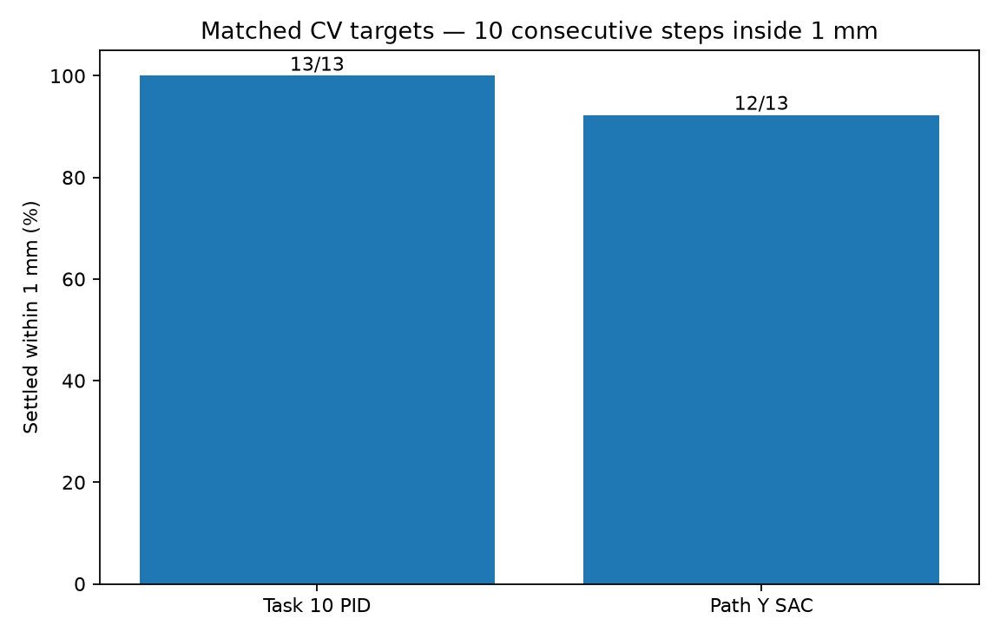
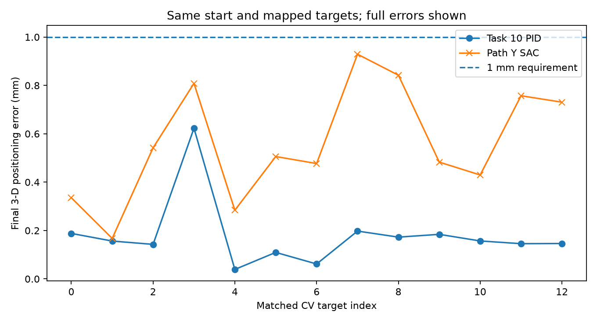
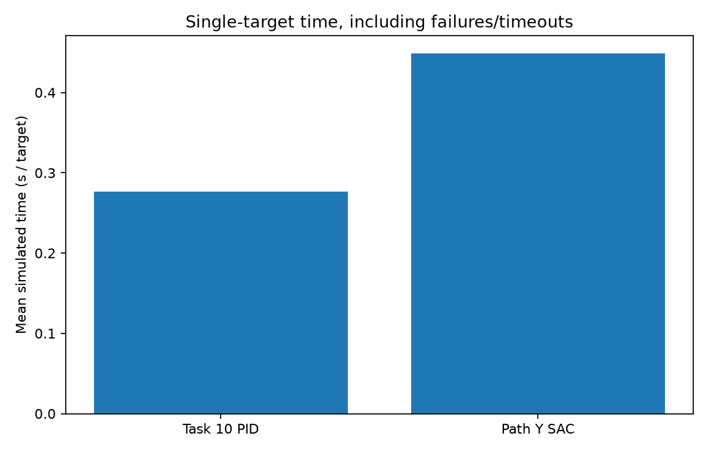

# Controller benchmarking — Matched controller benchmark (auto-generated)

This document reports **measured results** from the locked PID control controller
and my final Reinforcement learning control Path Y SAC model, without retraining.

| Metric | PID control tuned PID | Path Y SAC |
|---|---:|---:|
| CV-derived targets | 13 | 13 |
| Settled within 1 mm for 10 steps | 13/13 (100.0%) | 12/13 (92.3%) |
| Final below 1 mm | 13/13 | 13/13 |
| Mean final 3-D error (mm) | 0.1787 | 0.5609 |
| Median final 3-D error (mm) | 0.1564 | 0.5059 |
| Worst final 3-D error (mm) | 0.6229 | 0.9291 |
| Mean simulated time (s/target) | 0.277 | 0.448 |
| Unsafe terminations | 0 | 0 |

## Evaluation protocol

Both controllers use the **same `PathYEnv`**, identical Vision-guided integration CV mapped targets,
identical fixed initial pose (`PRACTICAL_ENVELOPE.center`), a 600-step budget,
a 240 Hz simulator and termination after **10 consecutive steps within 1 mm**.
SAC uses its trained 12-D observation and deterministic actions; PID uses the
original PID control `build_pid()` tuned gains and precise physical position. PID
integrators are reset for each trial. This is a *single-target* head-to-head
benchmark; reset between cases is identical for both. My trained SAC
checkpoint is untouched.

## Interpretation and limitations

- **Mapped coordinate error:** error measures the pipette versus the requested
  3-D coordinate produced by Vision-guided integration, *not* a measured biological root-tip error.
  Photo/plate registration remains assumed, not independently calibrated.
- No liquid dispensing or infection biology is simulated. Vision-guided integration deposits are
  visual success markers, not real inoculation.
- `simulated_time_s = steps / 240`; it is not physical hardware elapsed time.
  The CSV also contains inference/simulation wall-clock rollout duration, which
  depends on hardware and is not a fair estimate of robot actuation speed.
- This single-target comparison must **not** be conflated with Vision-guided integration's
  separate approach/hover/retreat timings or three-plate GIFs.
- The SAC model contains expert-imitation-guided training; inference uses only
  SAC policy actions. No PID teacher assists at inference.

## Visualizations

## Recommendations

1. Preserve the tuned PID as the reliable baseline when sub-mm stability is
   required; use the observed matched comparison to decide if SAC is suitable.
2. Reduce unproductive long RL trajectories and improve robust precision near
   1 mm if the recorded SAC error/timeout distribution warrants it.
3. Calibrate photo-to-robot coordinates using independent measured landmarks
   before making real root-tip accuracy claims.
4. Benchmark actual dispensing accuracy with measured droplet locations before
   translating this simulated waypoint performance to laboratory deployment.

The comparison uses **3 distinct plates** and **13 unique CV-derived root targets**. Full per-target results are in `matched_targets.csv`.
